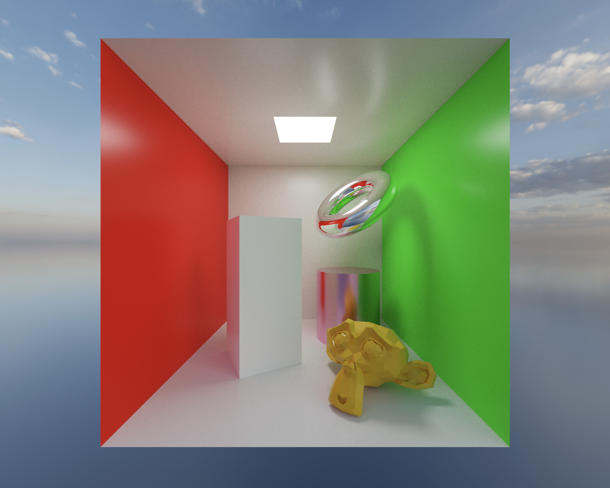

# [path-tracer](https://j-zg.github.io/path-tracer/)

<p align="center">
  
</p>

A demo real-time 3D path tracer using WebGPU ([wgpu](https://github.com/gfx-rs/wgpu)) and Rust, implementing modern rendering techniques.

## Features

* Material parameters and lighting calculations roughly follow [OpenPBR 1.2](https://github.com/AcademySoftwareFoundation/OpenPBR/tree/dev_1.2). Implements surface area heuristic BVH, Torrance-Sparrow and Energy-Preserving Oren-Nayar BRDFs, multiple importance sampling, support for textures, and more.
* Loads glTF 2.0 (.glb) files and renders in an interactable window. The scene and skybox can be modified in real time with the UI.
* Runs from the same Rust codebase natively and on the web (via WebAssembly). Uses a WGSL compute shader.

## Build & Run

Install [Rust](https://rustup.rs/ "rustup") and clone this repository:

```bash
git clone https://github.com/j-zg/path-tracer.git
cd path-tracer
```

### Native (Windows, MacOS, Linux)

Simply run:

```bash
cargo rr
```

### Web (Browser)

Install wasm-pack and build:

```bash
cargo install wasm-pack
wasm-pack build --target web
```

To start a server on localhost, use Python's built-in server `python3 -m http.server` or install simple-http-server, and then start hosting:

```bash
cargo install simple-http-server
simple-http-server
```

Open a browser, go to `http://localhost:8000`, and click on `index.html`.

> [!NOTE]
> Requires a browser with WebGPU [support](https://github.com/gpuweb/gpuweb/wiki/Implementation-Status "WebGPU Implementation Status") (Chrome 113+, Safari 26+, Firefox 145+).

### Command Line Interface

On native, render without opening an interactive window:

```bash
cargo rr -- render --scene assets/glb/box.glb --width 3840 --height 2160 --samples 128 --output render.png
```

Run `cargo rr -- render --help` for all options.

## General Crate Structure

```text
path-tracer/
├── assets/              # Scene, skybox, and UI assets
├── benches/             # Benchmarks
├── doc/                 # Images for the documentation
├── pkg/                 # Auto-generated by wasm-pack
├── src/
│   ├── render/          # Path tracing, shaders, scene and skybox management, UI, headless rendering
│   ├── lib.rs           # Entry points, window management, event loop, and command-line arguments
│   ├── logger.rs        # Logging and communication with JavaScript
│   └── main.rs          # Native entry point
├── Cargo.toml           # Dependencies, features, benches, lints
└── index.html           # Webpage
```

## Development

* `cargo c` and `cargo cw`: Run Clippy for linting native and `target_arch = "wasm32"` code, respectively.
* `cargo t`: Run with `testing` feature enabled, allowing more debug information to be outputted during running (which may significantly worsen performance). `testing` feature is only supported on native, since debug output files are saved to disk, in `debug_output/` (which is gitignored). If there are errors during build related to C++, it's often because build tools are missing; one option is to install them through [Build Tools for Visual Studio](https://visualstudio.microsoft.com/downloads/#build-tools-for-visual-studio-2026). Profiling with Tracy is supported:
    1. Download [Tracy](https://github.com/wolfpld/tracy/releases/).
    1. Have the Tracy profiler open while path-tracer is running. path-tracer-app should appear under the discovered clients.
* `cargo bench --bench filename -- function`: Run a benchmark. `filename` is a filename in [`benches/`](https://github.com/j-zg/path-tracer/tree/main/benches), and `function` is the ID of a `bench_function`. Criterion is used; view the detailed benchmark reports at `target/criterion/report/index.html`.
* `cargo doc --open --document-private-items --no-deps --target wasm32-unknown-unknown`: Generate and view the documentation.

To see a translated WGSL shader, use `naga-cli`:

```bash
cargo install naga-cli
naga input.wgsl output.hlsl # or .metal or .spv
```

For SPIR-V specifically, `spirv-dis` can be installed from [LunarG](https://vulkan.lunarg.com/sdk/home#) if it's missing, and can be used to convert binary to readable text: `spirv-dis output.spv -o output_readable.txt`.

Tracing with [NVIDIA Nsight](https://developer.nvidia.com/nsight-systems/get-started) works; just copy [`assets/`](https://github.com/j-zg/path-tracer/tree/main/assets) to the same directory as the executable (in `target/release/`).
